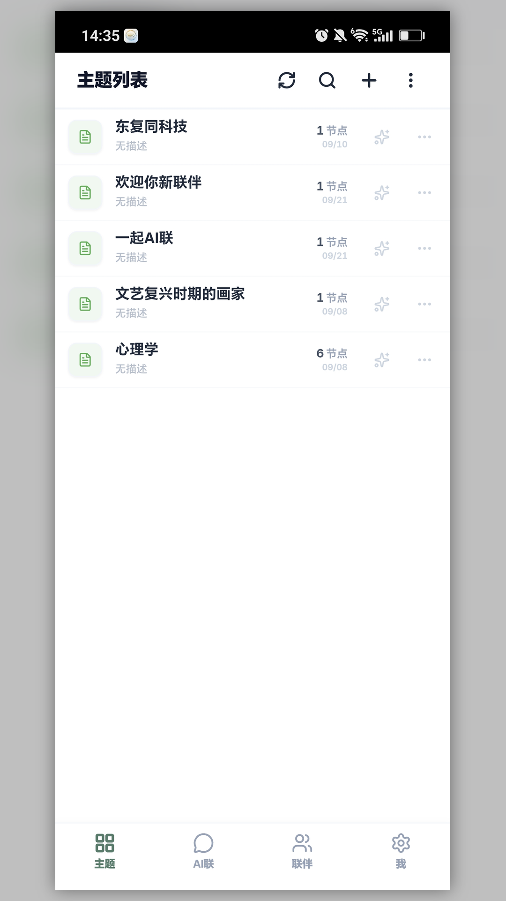
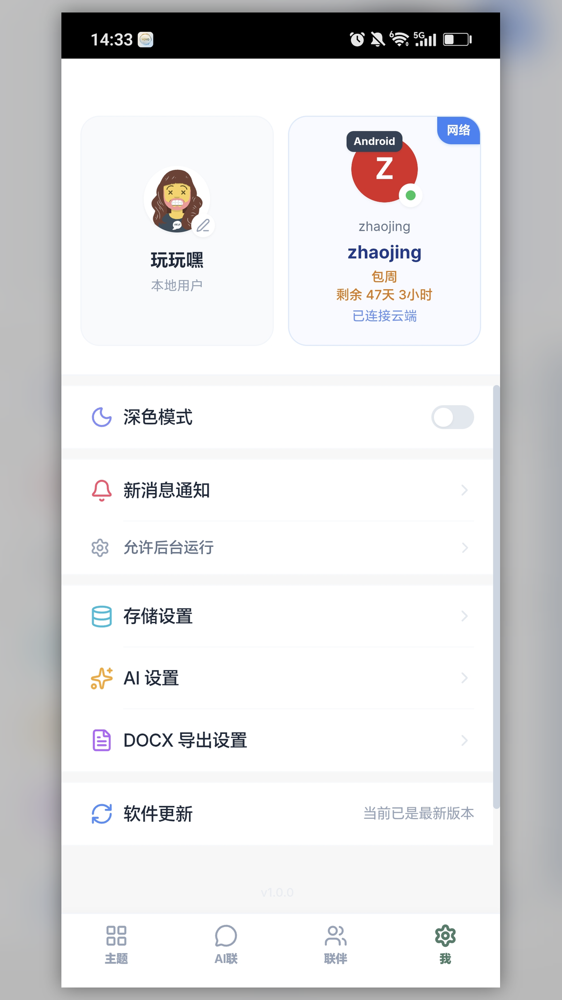
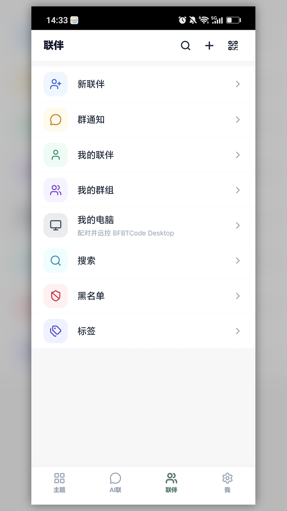
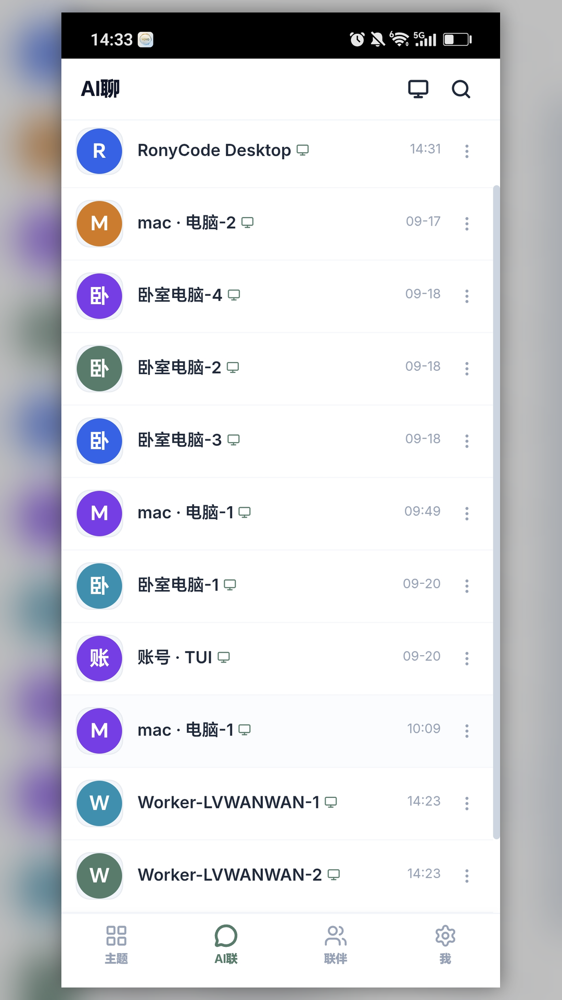

# DTworkeasy Mobile

<p align="center">
  
</p>

<p align="center">
  <strong>DTworkeasy</strong> is the <em>free</em> Android / iOS companion from
  <a href="https://www.dtrony.com">DTrony / 东复同</a>:<br/>
  files · collaboration · messaging · QR-pair remote control of
  <strong>BFBT Code</strong> and <strong>BFBTbridge</strong> on your PC.
</p>

<p align="center"><strong>人在外面，活照干。</strong> · 手机端智能协同 · 注册即可免费使用</p>

> This GitHub repository is **distribution-only** (Android APKs + docs). **No source code.**
> The app on the phone is named **DTworkeasy**; this repo is **DTworkeasy-Mobile**.
> It is **not** BFBT Code and **not** BFBTbridge.

官网：[www.dtrony.com](https://www.dtrony.com) ·
文档：[安装 DTworkeasy](https://www.dtrony.com/docs/install-dtworkeasy) ·
[快速开始](https://www.dtrony.com/docs/getting-started) ·
[会员权益](https://www.dtrony.com/docs/membership-benefits) ·
App Store：[DTworkeasy](https://apps.apple.com/cn/app/dtworkeasy/id6806894230) ·
姊妹仓库：[BFBT Code](https://github.com/dongfutong/BFBTCode) ·
[BFBTbridge](https://github.com/dongfutong/BFBTbridge)

---

## 三个产品怎么区分

| 名称 | 是什么 | 要会员吗 | 仓库 |
|------|--------|----------|------|
| **DTworkeasy**（本仓库 *DTworkeasy-Mobile*） | 手机 App（Android / iOS）：文件、协同、沟通；扫码远控电脑 | **免费**（注册官网账号即可） | [DTworkeasy-Mobile](https://github.com/dongfutong/DTworkeasy-Mobile) |
| **BFBT Code** | 电脑端 AI 编程助手（Windows / macOS 桌面版，Linux 终端版） | 需试用或会员 | [BFBTCode](https://github.com/dongfutong/BFBTCode) |
| **BFBTbridge** | 电脑常驻桥接：把本机 Cursor / Codex / BFBT Code 交给手机扫码使用 | 需试用或会员（规则与 BFBT Code 相同） | [BFBTbridge](https://github.com/dongfutong/BFBTbridge) |

```
手机 DTworkeasy（本仓库，注册即免费）
        │ 同一 www.dtrony.com 账号 · 扫码配对
        ├──► BFBT Code 桌面版 / 终端版（电脑，试用或会员）
        └──► BFBTbridge（电脑常驻，试用或会员）──► 本机 Cursor / Codex / BFBT Code
```

请不要把本仓库叫成 “BFBT Code 手机版” 或 “Bridge”。商店与界面上的应用名是 **DTworkeasy**；电脑端两款产品分别是 **BFBT Code** 与 **BFBTbridge**。

---

## 中文

### 一句话简介

**DTworkeasy** 是[成都东复同科技股份有限公司](https://www.dtrony.com)（DTrony）的**手机端协同软件**：在手机上管理文件、协同文档、与同事即时沟通；也可远程控制电脑上的 **BFBT Code**，或经 **BFBTbridge** 使用本机已安装的 Cursor / Codex。注册[官网](https://www.dtrony.com)账号即可**免费使用**，**不要求会员**。

远控电脑时，电脑端 BFBT Code 和/或 BFBTbridge 必须处于试用或会员可用状态；只装手机、电脑端已过期，无法远控。手机 App 本身仍然免费。

### 主要特性

- 📁 **文件管理**：在手机上整理与访问工作文件
- 💬 **即时通讯**：与团队保持沟通
- 🖥️ **远程控制**：扫码连接电脑端 [BFBT Code](https://github.com/dongfutong/BFBTCode) 或 [BFBTbridge](https://github.com/dongfutong/BFBTbridge)，人在外面也能继续干活
- 🔐 **统一账号**：与 [www.dtrony.com](https://www.dtrony.com)、BFBT Code、BFBTbridge 同一套东复同账号登录
- 🆓 **免费使用**：DTworkeasy 对所有注册用户免费（电脑端 BFBT Code 与 BFBTbridge 需试用或会员）

说明均与官网文档一致，见 [安装 DTworkeasy](https://www.dtrony.com/docs/install-dtworkeasy)、[用手机远控桌面版](https://www.dtrony.com/docs/remote-desktop)、[用手机远控终端版](https://www.dtrony.com/docs/remote-tui)、[安装与使用 BFBTbridge](https://www.dtrony.com/docs/agent-bridge)、[会员权益](https://www.dtrony.com/docs/membership-benefits)。

### 系统要求

| 平台 | 说明 |
|------|------|
| Android | 安装官网 / 本仓库提供的 APK（请勿从不明来源下载） |
| iOS | App Store 搜索 **DTworkeasy**，或打开 [App Store 链接](https://apps.apple.com/cn/app/dtworkeasy/id6806894230) |

### 安装步骤

#### Android

1. 从本仓库 [Releases](../../releases) 下载 APK，或打开 [官网下载中心](https://www.dtrony.com/) 选择 Android →「直接下载」
2. 打开 APK；若系统提示未知来源，允许当前浏览器 / 文件管理器安装
3. 打开 DTworkeasy，使用东复同账号登录（未注册请先在[官网](https://www.dtrony.com)注册）

推荐优先使用与官网一致的正式包：`DTworkeasy-android-1.0.8.26101901.apk`（universal）。

#### iOS

1. 打开 [App Store — DTworkeasy](https://apps.apple.com/cn/app/dtworkeasy/id6806894230) 或在下载中心点「前往 App Store」
2. 安装后使用同一官网账号登录  
官网 **不提供 IPA 直链**，请通过 App Store 安装与更新。

### 下载表（Release 资源）

| 平台 | 文件名 | 说明 |
|------|--------|------|
| Android（官网正式包） | `DTworkeasy-android-1.0.8.26101901.apk` | universal，与官网下载中心一致 |
| iOS | — | 仅 App Store：https://apps.apple.com/cn/app/dtworkeasy/id6806894230 |

### 截图

| 主题列表 | 「我」与账号 |
|:---:|:---:|
|  |  |
| **联伴与我的电脑** | **AI聊 / 已配对电脑** |
|  |  |

<p align="center"></p>

### 与姊妹产品一起用

1. 电脑安装 [BFBT Code](https://github.com/dongfutong/BFBTCode)（试用或会员）— 需要远控 BFBT Code 桌面版 / 终端版时
2. 如需从手机使用本机 **Cursor** / **Codex** 等，另装 [BFBTbridge](https://github.com/dongfutong/BFBTbridge) 并保持运行（同样需试用或会员，规则与 BFBT Code 相同）
3. 手机安装 **DTworkeasy**（本仓库 / App Store）并登录同一 [www.dtrony.com](https://www.dtrony.com) 账号，扫码配对

远控时：电脑端 BFBT Code 与/或 BFBTbridge 必须处于试用或会员可用状态；仅装手机端而电脑端产品已过期，无法远控。DTworkeasy 本身保持免费。

### 许可与声明

本仓库为 **发行版分发仓库**，仅包含安装包与说明文档，**不包含源代码**。  
软件版权归 **成都东复同科技股份有限公司** 所有。请只从本仓库或 [www.dtrony.com](https://www.dtrony.com) 下载 Android APK。隐私政策：https://www.dtrony.com/api/legal/privacy

---

## English

### One-liner

**DTworkeasy** (this repo: **DTworkeasy-Mobile**) is Dongfutong / [DTrony](https://www.dtrony.com)’s **free** mobile companion for Android and iOS: files, collaboration, and messaging on your phone — plus QR-pair remote control of **BFBT Code** or **BFBTbridge** on a PC. Same account as the website. **No membership required for the phone app.**

It is **not** the BFBT Code IDE and **not** the BFBTbridge PC tray app. Those live in sibling repositories.

### Features

- File management and team messaging on your phone
- Remote control of [BFBT Code](https://github.com/dongfutong/BFBTCode) and/or [BFBTbridge](https://github.com/dongfutong/BFBTbridge) on Windows, macOS, or Linux (QR pairing)
- Same Dongfutong account as [www.dtrony.com](https://www.dtrony.com), BFBT Code, and BFBTbridge
- Free mobile use; BFBT Code and BFBTbridge on the PC still need an active trial or membership

Official docs: [Install DTworkeasy](https://www.dtrony.com/docs/install-dtworkeasy) · [Remote desktop](https://www.dtrony.com/docs/remote-desktop) · [Remote TUI](https://www.dtrony.com/docs/remote-tui) · [BFBTbridge](https://www.dtrony.com/docs/agent-bridge) · [Membership](https://www.dtrony.com/docs/membership-benefits)

### Install

**Android:** download an APK from [Releases](../../releases) or the [official download center](https://www.dtrony.com/). Prefer `DTworkeasy-android-1.0.8.26101901.apk` for the site-published build. Allow install from unknown sources if prompted, then sign in.

**iOS:** install from the [App Store](https://apps.apple.com/cn/app/dtworkeasy/id6806894230). No IPA is published on the website.

### Sister products

- [BFBT Code](https://github.com/dongfutong/BFBTCode) — AI coding IDE (Windows / macOS / Linux TUI); requires an active trial or membership  
- [BFBTbridge](https://github.com/dongfutong/BFBTbridge) — PC-resident bridge for Cursor / Codex / remote agents; same trial-or-membership rule as BFBT Code  

Remote control only works while the PC-side product(s) you connect through (BFBT Code and/or BFBTbridge) are in an active trial or membership — the phone app alone is not enough if the PC products have expired. DTworkeasy on the phone stays free.

### License note

**Distribution-only** repo (installers + docs, **no source**).  
© Chengdu Dongfutong Technology Co., Ltd. · https://www.dtrony.com

---

## 日本語（抜粋）

**DTworkeasy**（リポジトリ名 **DTworkeasy-Mobile**）は東復同（[www.dtrony.com](https://www.dtrony.com)）のスマホ向けコラボアプリです。ファイル管理・コミュニケーションに加え、QR で PC 上の **BFBT Code** または **BFBTbridge** を遠隔操作できます。登録すれば**無料**（会員不要）。本アプリは BFBT Code でも BFBTbridge でもありません。PC 側の BFBT Code / BFBTbridge には試用または会員が必要です。Android は本リポジトリまたは公式サイトの APK、iOS は [App Store](https://apps.apple.com/cn/app/dtworkeasy/id6806894230)。配布専用（ソース無し）。

- 姉妹リポジトリ：[BFBT Code](https://github.com/dongfutong/BFBTCode) · [BFBTbridge](https://github.com/dongfutong/BFBTbridge)

## 한국어（요약）

**DTworkeasy**（저장소명 **DTworkeasy-Mobile**）는 Dongfutong / DTrony（[www.dtrony.com](https://www.dtrony.com)）의 모바일 협업 앱입니다. 파일·메시지와 함께 QR로 PC의 **BFBT Code** 또는 **BFBTbridge**를 원격 제어할 수 있습니다. 회원가입만 하면 **무료**(멤버십 불필요). 이 앱은 BFBT Code도 BFBTbridge도 아닙니다. PC 측 BFBT Code / BFBTbridge는 체험 또는 멤버십이 필요합니다. Android는 본 저장소/공식 APK, iOS는 [App Store](https://apps.apple.com/cn/app/dtworkeasy/id6806894230). 배포 전용(소스 없음).

- 자매 저장소: [BFBT Code](https://github.com/dongfutong/BFBTCode) · [BFBTbridge](https://github.com/dongfutong/BFBTbridge)

---

**Suggested Release tag:** `v1.0.8.26101901`（对齐官网 Android）  
**iOS:** App Store `1.0.13`（build 26101701）  
**Docs:** https://www.dtrony.com/docs/install-dtworkeasy · https://www.dtrony.com/docs
