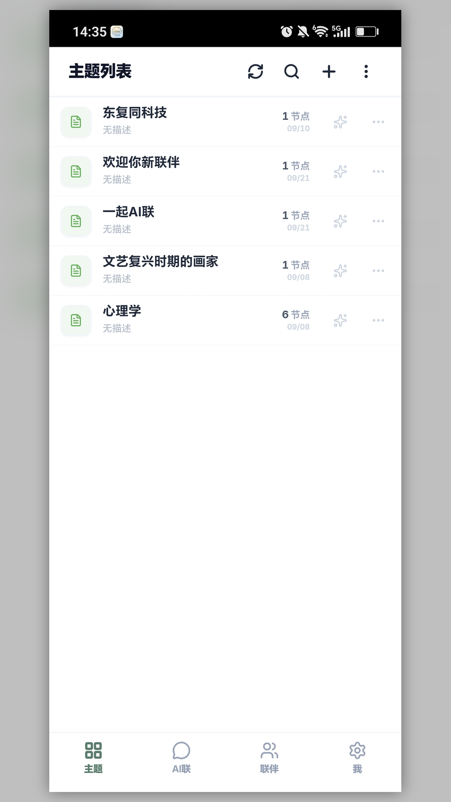
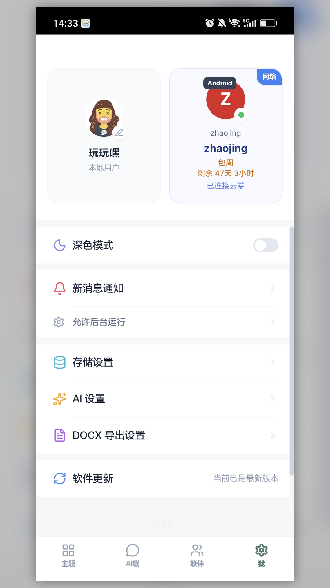
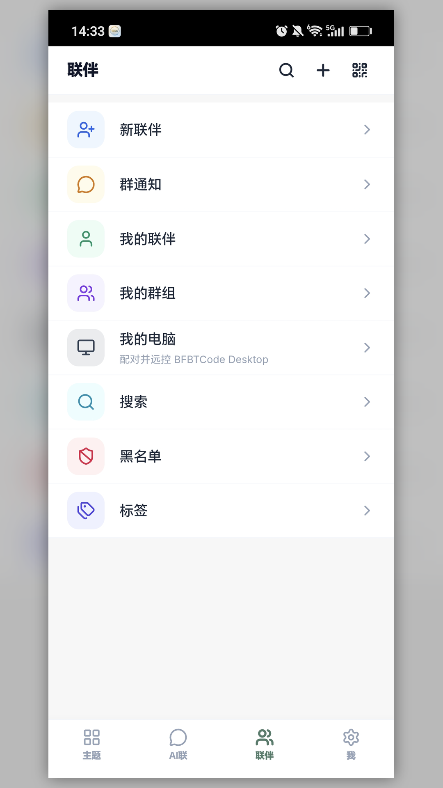
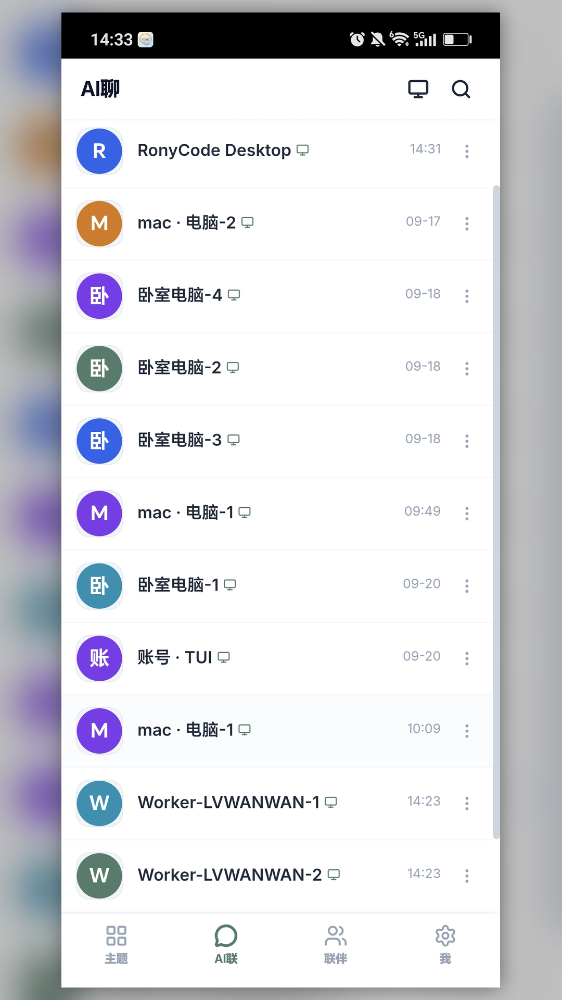

# DTworkeasy

  

<strong>人在外面，活照干。</strong> · 手机端智能协同 · 文件 · 沟通 · 远控 BFBT Code

> Distribution-only repository. Installers and docs only — **no source code**.

官网：[www.dtrony.com](https://www.dtrony.com) · 文档：[安装 DTworkeasy](https://www.dtrony.com/docs/install-dtworkeasy) · App Store：[DTworkeasy](https://apps.apple.com/cn/app/dtworkeasy/id6806894230) · 姊妹产品：[BFBT Code](https://github.com/dongfutong/BFBTCode) · [BFBTbridge](https://github.com/dongfutong/BFBTbridge)

---

## 中文

### 一句话简介

**DTworkeasy** 是东复同科技的手机端协同软件：管理文件、协同文档、与同事即时沟通；也可远程控制电脑上的 **BFBT Code**（需电脑端安装 BFBTbridge 或桌面版并完成配对）。注册官网账号即可免费使用，**不要求会员**。

### 主要特性

- 📁 **文件管理**：在手机上整理与访问工作文件
- 💬 **即时通讯**：与团队保持沟通
- 🖥️ **远程控制**：连接电脑端 BFBT Code / BFBTbridge，人在外面也能继续干活
- 🔐 **统一账号**：与官网、BFBT Code 同一套账号登录
- 🆓 **免费使用**：DTworkeasy 对所有注册用户免费（电脑端 BFBT Code 与 BFBTbridge 需试用或会员）

### 系统要求

| 平台 | 说明 |
|------|------|
| Android | 安装官网 / 本仓库提供的 APK（请勿从不明来源下载） |
| iOS | App Store 搜索 **DTworkeasy**，或打开 [App Store 链接](https://apps.apple.com/cn/app/dtworkeasy/id6806894230) |

### 安装步骤

#### Android

1. 从本仓库 [Releases](../../releases) 下载 APK，或打开 [官网下载中心](https://www.dtrony.com/) 选择 Android →「直接下载」
2. 打开 APK；若系统提示未知来源，允许当前浏览器 / 文件管理器安装
3. 打开 DTworkeasy，使用东复同账号登录（未注册请先在官网注册）

推荐优先使用与官网一致的正式包：`DTworkeasy-android-1.0.8.26101901.apk`（universal）。

#### iOS

1. 打开 [App Store — DTworkeasy](https://apps.apple.com/cn/app/dtworkeasy/id6806894230) 或在下载中心点「前往 App Store」
2. 安装后使用同一官网账号登录  
官网 **不提供 IPA 直链**，请通过 App Store 安装与更新。

### 下载表（Release 资源）

| 平台 | 文件名 | 说明 |
|------|--------|------|
| Android（官网正式包） | `DTworkeasy-android-1.0.8.26101901.apk` | universal，与官网下载中心一致 |
| iOS | — | 仅 App Store：https://apps.apple.com/cn/app/dtworkeasy/id6806894230 |

### 截图

| | |
|:---:|:---:|
|  |  |
|  |  |

### 与姊妹产品一起用

1. 电脑安装 [BFBT Code](https://github.com/dongfutong/BFBTCode)（试用或会员）
2. 如需远控 Cursor / Codex 等，另装 [BFBTbridge](https://github.com/dongfutong/BFBTbridge) 并保持运行（同样需试用或会员，规则与 BFBT Code 相同）
3. 手机安装本应用并登录同一账号，扫码配对

远控时：电脑端 BFBT Code 与/或 BFBTbridge 必须处于试用或会员可用状态；仅装手机端而电脑端产品已过期，无法远控。

### 许可与声明

本仓库为 **发行版分发仓库**，仅包含安装包与说明文档，**不包含源代码**。  
软件版权归 **成都东复同科技股份有限公司** 所有。请只从本仓库或 [www.dtrony.com](https://www.dtrony.com) 下载 Android APK。隐私政策：https://www.dtrony.com/api/legal/privacy

---

## English

### One-liner

**DTworkeasy** is Dongfutong’s mobile companion: files, collaboration, messaging — and remote control of **BFBT Code** on your PC. Free for all registered users (no membership required for the mobile app).

### Features

- File management and team messaging on your phone
- Remote control of BFBT Code / BFBTbridge on Windows, macOS, or Linux
- Same account as www.dtrony.com and BFBT Code
- Free mobile use; BFBT Code and BFBTbridge on the PC still need an active trial or membership

### Install

**Android:** download an APK from [Releases](../../releases) or the [official download center](https://www.dtrony.com/). Prefer `DTworkeasy-android-1.0.8.26101901.apk` for the site-published build. Allow install from unknown sources if prompted, then sign in.

**iOS:** install from the [App Store](https://apps.apple.com/cn/app/dtworkeasy/id6806894230). No IPA is published on the website.

### Sister products

- [BFBT Code](https://github.com/dongfutong/BFBTCode) — AI coding IDE (Windows / macOS / Linux TUI); requires an active trial or membership  
- [BFBTbridge](https://github.com/dongfutong/BFBTbridge) — PC-resident bridge for Cursor / Codex / remote agents; same trial-or-membership rule as BFBT Code  

Remote control only works while the PC-side product(s) you connect through (BFBT Code and/or BFBTbridge) are in an active trial or membership — the phone app alone is not enough if the PC products have expired.

### License note

**Distribution-only** repo (installers + docs, **no source**).  
© Chengdu Dongfutong Technology Co., Ltd.

---

## 日本語（抜粋）

**DTworkeasy** はスマホ向けコラボアプリです。ファイル管理・コミュニケーションに加え、PC 上の BFBT Code を遠隔操作できます。登録すれば無料（会員不要）。PC 側の BFBT Code / BFBTbridge には試用または会員（メンバーシップ）が必要です。Android は本リポジトリまたは公式サイトの APK、iOS は App Store。配布専用（ソース無し）。https://www.dtrony.com

## 한국어（요약）

**DTworkeasy**는 모바일 협업 앱입니다. 파일·메시지와 함께 PC의 BFBT Code를 원격 제어할 수 있습니다. 회원가입만 하면 무료(멤버십 불필요). PC 측 BFBT Code / BFBTbridge는 체험 또는 멤버십이 필요합니다. Android는 본 저장소/공식 APK, iOS는 App Store. 배포 전용(소스 없음). https://www.dtrony.com

---

**Suggested Release tag:** `v1.0.8.26101901`（对齐官网 Android）  
**iOS:** App Store `1.0.13`（build 26101701）  
**Docs:** https://www.dtrony.com/docs/install-dtworkeasy
